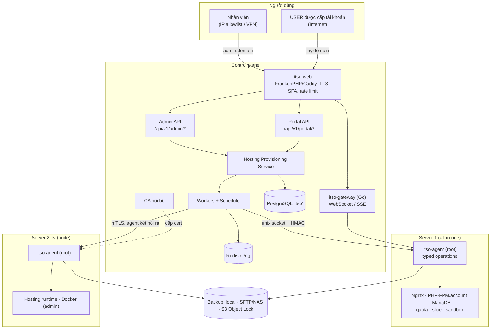
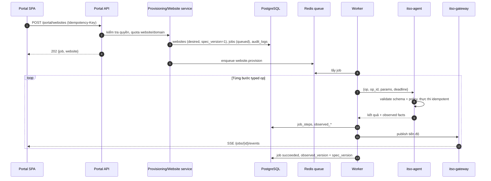
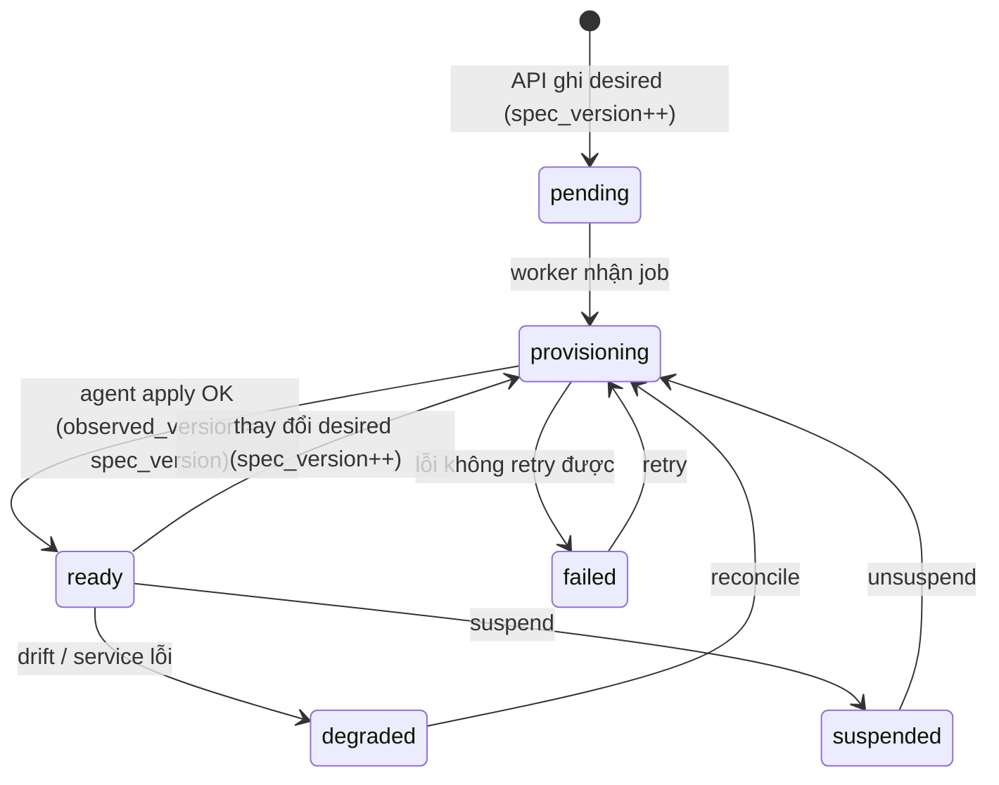
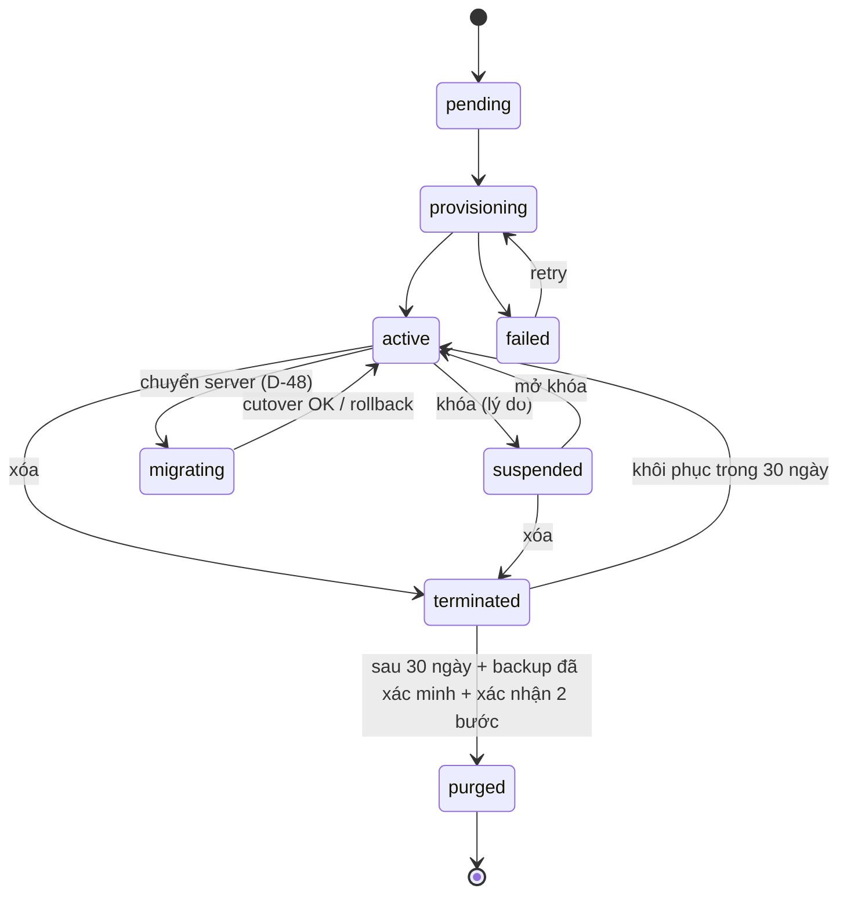
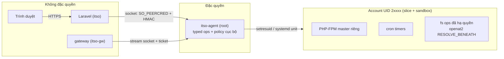
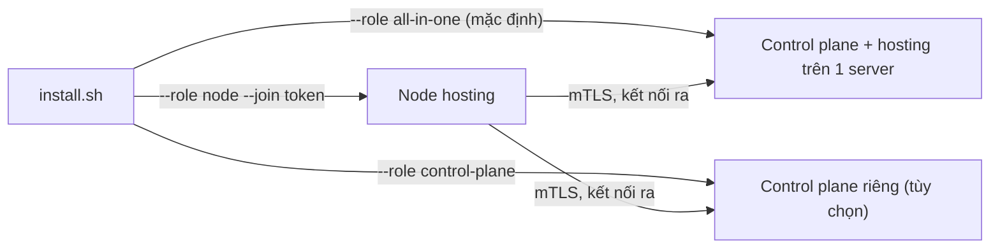

# ARCHITECTURE — ITSO Panel

> Phạm vi: hệ thống quản trị máy chủ và Hosting **dùng nội bộ** (APPROVED 2026-11-20).
> Chi tiết kỹ thuật thêm: [02 Kiến trúc](docs/planning/02-ARCHITECTURE.md), [06 Agent security](docs/planning/06-AGENT-SECURITY.md), [07 Cách ly và quota](docs/planning/07-HOSTING-ISOLATION.md), [08 Backup](docs/planning/08-BACKUP.md), [09 Docker](docs/planning/09-DOCKER.md), [10 Installer](docs/planning/10-INSTALLER.md).
> Quyết định: [DECISIONS.md](DECISIONS.md) và [docs/adr](docs/adr/README.md). Mô hình đe dọa: [docs/security/threat-model.md](docs/security/threat-model.md).

## 1. Tổng quan thành phần

| Thành phần | User Linux | Trách nhiệm | Không được làm |
|---|---|---|---|
| Frontend (`apps/web`, entry `admin` + `portal`) | — | UI, i18n, theme, gọi API, hiển thị job | Chứa secret; tự quyết định quyền |
| Admin API / Portal API (Laravel) | `itso` | Auth theo realm, RBAC, validation, desired state, tạo job, audit | Chạy lệnh hệ thống; có root/sudo |
| Hosting Provisioning Service | `itso` | Duy nhất xử lý vòng đời account (tạo, đổi gói, khóa/mở, chuyển server, xóa) | Bị bỏ qua bởi controller hay CLI |
| Workers / Scheduler | `itso` | Thực thi job, gọi agent, cập nhật observed state, lịch backup, drift check | Như API |
| itso-gateway (Go) | `itso-gw` | Terminal, log stream, tiến độ job; xác thực ticket ngắn hạn | Tự quyết định quyền |
| itso-agent (Go) | `root` (hardened) | Typed operations, reconcile, metrics, policy cục bộ, audit cục bộ | Nhận shell/path tùy ý |
| CLI `itso` (Go) | root (sudo) | install, update, rollback, repair, uninstall, node join, policy | — |
| PostgreSQL `itso`, Redis riêng | hệ thống | Trạng thái panel, queue, lock | Phục vụ dữ liệu của USER |

## 2. Hai bề mặt truy cập (D-25, D-40)

| | Private Admin Panel | User Hosting Portal |
|---|---|---|
| Origin | `admin.<domain>` | `my.<domain>` |
| Mạng | IP allowlist / VPN | Public Internet |
| Người dùng | `users.realm = admin` (SUPER_ADMIN, ADMIN) | `users.realm = portal` (USER) |
| Auth | Session cookie + CSRF, MFA bắt buộc, step-up cho thao tác nguy hiểm | Session cookie + CSRF, MFA (bắt buộc nếu có SSH/Terminal), khóa lũy tiến, CAPTCHA |
| Bảo vệ | CSP, rate limit | CSP, rate limit, WAF (OWASP CRS) |
| API | `/api/v1/admin/*` | `/api/v1/portal/*` |

`realm` không đổi được sau khi tạo (trigger DB). Guard `admin` chỉ chấp nhận realm `admin`, guard `portal` chỉ chấp nhận realm `portal`. Truy cập tài nguyên ngoài phạm vi trả `404`.

## 3. Luồng tạo website

Các bước của `website.provision`: `fs.site_layout.ensure` → `php.pool.apply` → `nginx.vhost.apply` (render → `nginx -t` → đổi file nguyên tử → reload, lỗi thì khôi phục) → `cert.issue` (nếu bật SSL). Lỗi tạm thời được retry có backoff. Lỗi validation hoặc policy thì không retry, chạy compensation.

## 4. Desired / Observed / Job state

| Loại | Lưu ở đâu | Ai ghi |
|---|---|---|
| Desired | Cột cấu hình + `spec_version` | API / Provisioning Service |
| Observed | `observed_version`, `status`, `observed_facts`, `drift`, `observed_at` | Worker, từ kết quả agent |
| Job | `jobs`, `job_steps`, `job_logs` | Worker |

Agent không giữ desired state lâu dài: mỗi lần apply nhận spec đầy đủ, nên `itso repair --reapply-all` chỉ việc gửi lại toàn bộ desired state.

## 5. Vòng đời Hosting Account (D-46)

Trước khi purge bắt buộc phải: gửi cảnh báo cho người dùng và admin (lúc terminate, T-7, T-1); ghi audit mọi bước; xác minh backup cuối hợp lệ (`restic check` + restore thử vào sandbox); khôi phục được bất kỳ lúc nào trước purge. `legal_hold` chặn purge. Purge xong sinh biên bản (`purge_records`).

## 6. Ranh giới đặc quyền

- Laravel bị chiếm vẫn chỉ gọi được typed ops. Các op nguy hiểm (root terminal, `backup.forget`, docker) bị tắt bằng policy cục bộ `/etc/itso/agent-policy.yaml`, chỉ root sửa được qua CLI.
- Mọi thao tác trên dữ liệu của account chạy dưới UID của account, không bao giờ dưới root.

## 7. Cách ly và quota (giữ nguyên đầy đủ)

| Lớp | Cơ chế |
|---|---|
| Danh tính | UID/GID riêng, dải 20000–59999, không tái dùng trong 90 ngày (D-45) |
| PHP | PHP-FPM master riêng chạy dưới UID account, `pm=ondemand` (D-12) |
| CPU/RAM/process/IO | `itso-acct-<id>.slice`: `CPUQuota`, `MemoryHigh/Max`, `TasksMax`, `IOWeight`, `IO*BandwidthMax` |
| Disk/inode | Kernel user quota (ext4/XFS) |
| Sandbox | `ProtectSystem=strict`, `ProtectHome=tmpfs` + BindPaths, `ProtectProc=invisible`, `PrivateTmp`, `NoNewPrivileges` (D-29) |
| Database | DB user riêng theo tiền tố, không quyền global, `MAX_USER_CONNECTIONS` |
| SFTP/SSH | `internal-sftp` chroot; SSH mặc định tắt, khi bật thì jail (D-21) |
| Mạng | Egress per UID: chặn port 25 và dải nội bộ/metadata (D-10, D-17) |
| Backup | Repo restic riêng cho mỗi account (D-23); offsite immutable (D-19) |

## 8. Topology và multi-server (D-41, D-48)

Chuyển account giữa các server: preflight → tạo account ở đích → sync file (rsync) và DB (dump/import) → sao chép SSL, cron, cấu hình nginx/php/sftp, ownership/UID → kiểm tra dữ liệu (checksum file, row count + checksum bảng, HTTP check) → cutover (khóa ghi ở nguồn, sync lần cuối, bật ở đích) → giữ nguồn N ngày → dọn dẹp. Có rollback ở mọi bước trước khi dọn dẹp.

## 9. Bố cục filesystem

| Đường dẫn | Nội dung | Update ghi đè | Uninstall xóa |
|---|---|---|---|
| `/opt/itso/releases/<ver>/`, `/opt/itso/current` | Release và symlink bản đang chạy | Thêm bản mới, đổi symlink nguyên tử | Có |
| `/etc/itso/` | Cấu hình, policy agent, PKI | Không (merge) | Giữ bản sao |
| `/var/lib/itso/` | PostgreSQL panel, master key, state | Không | Chỉ khi `--purge-panel-data` |
| `/var/log/itso/` | Log, audit cục bộ | Không | Hỏi |
| `/var/backups/itso/` | Backup trước update, repo local | Không | **Không bao giờ** |
| `/home/<account>/` | Dữ liệu hosting | Không | **Không bao giờ** |
| `/var/lib/mysql`, `/var/lib/postgresql/16/main` | DB của hosting | Không | **Không bao giờ** |

## 10. systemd units

| Unit | Mô tả |
|---|---|
| `itso.target` | Gom mọi service panel |
| `itso-agent.service` | Agent root, socket `/run/itso/agent.sock` |
| `itso-web.service` | FrankenPHP + Laravel Octane (D-01, Proposed) |
| `itso-worker@.service` | Queue workers |
| `itso-scheduler.service` | Scheduler |
| `itso-gateway.service` | Realtime |
| `postgresql@16-itso.service`, `itso-redis.service` | DB và Redis của panel |
| `itso-php@<ver>-<acct>.service` | PHP-FPM master của account, trong `itso-acct-<id>.slice` |
| `itso-cron-<id>.timer/.service` | Cron của account |

## 11. Cấu trúc repository

Xem [README.md](README.md). Nguồn sự thật: `contracts/` (API, agent ops) → codegen cho `apps/web` (TypeScript) và `agent` (Go).

## 12. Mở rộng tương lai (DEFERRED)

Public Provisioning API (`/api/provisioning/*` giữ chỗ), Customer/Subscription, Placement Engine tự động, Docker Hosting trên VM. Tham khảo [15-HOSTING-PROVIDER.md](docs/planning/15-HOSTING-PROVIDER.md).
