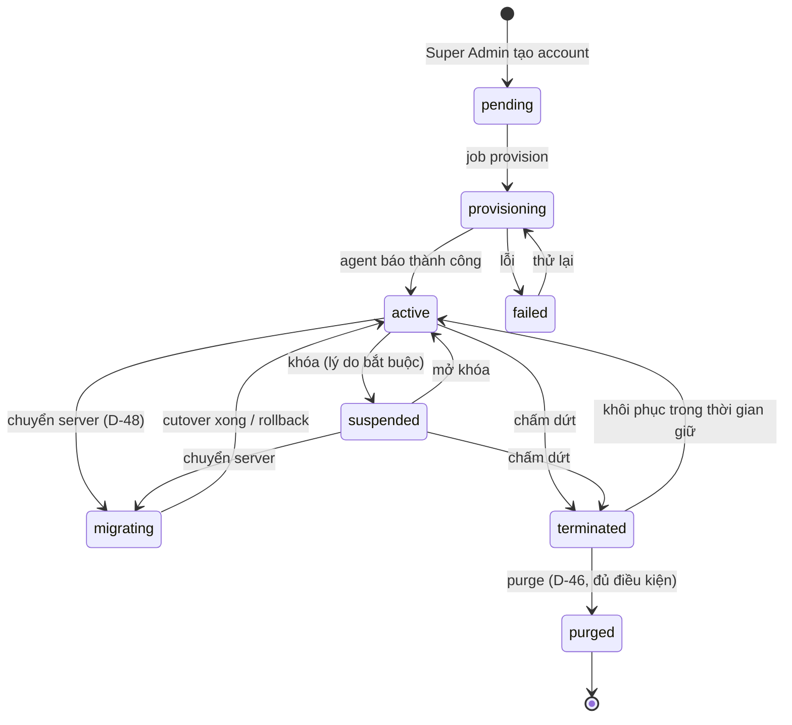

# Vòng đời Hosting account

Cột `hosting_accounts.lifecycle_state`; mỗi lần chuyển trạng thái ghi một dòng `account_lifecycle_events` (append-only). Mọi chuyển trạng thái đi qua **Hosting Provisioning Service** (D-49), dùng chung cho Admin Panel và CLI.

## 1. Sơ đồ trạng thái

| Trạng thái | Website | SFTP/SSH | Dữ liệu | Ghi chú |
|---|---|---|---|---|
| `pending` | Chưa có | Chưa có | Chưa có | Bản ghi đã tạo, chờ job |
| `provisioning` | Đang tạo | Đang tạo | Đang tạo | Job chạy trên agent |
| `active` | Phục vụ | Cho phép | Đầy đủ | |
| `suspended` | Trang "tạm khóa" | Chặn | Giữ nguyên | `suspended_reason` bắt buộc; cron dừng |
| `migrating` | Phục vụ ở nguồn tới khi cutover | Chỉ đọc khi cutover | Đang đồng bộ | Xem `account_migrations` |
| `terminated` | Tắt | Chặn | **Giữ ≥ 30 ngày** | `terminated_at`, `purge_after` bắt buộc (CHECK) |
| `purged` | Đã xóa | Đã xóa | Đã xóa, trừ backup theo chính sách | Không quay lại được |
| `failed` | Không xác định | Chặn | Tùy bước lỗi | Super Admin thử lại hoặc chấm dứt |

## 2. Quy trình purge (D-46)

Thời gian giữ: `purge_after = terminated_at + hosting_package_versions.retention_days_after_terminate` (CHECK ≥ 30 ngày).

1. **Chấm dứt:** account sang `terminated`. Gửi cảnh báo cho Super Admin và chủ account; ghi audit.
2. **Cảnh báo bắt buộc:** thông báo nhắc lúc còn 7 ngày và 1 ngày trước `purge_after`.
3. **Backup cuối:** tạo snapshot cuối (`backup_snapshots`), chạy `backup_verifications` (restic check + restore thử một phần vào thư mục tạm) để xác nhận **khôi phục được**. Ghi `purge_records.final_backup_snapshot_id` và `backup_verified_at`.
4. **Biên bản 2 bước:** người yêu cầu tạo `purge_records`, một Super Admin **khác** xác nhận (`confirmed_by_user_id ≠ requested_by_user_id`), nhập lại username account để xác nhận.
5. **Purge:** job xóa home, DB, user hệ thống, vhost, cron, SFTP; ghi danh sách đối tượng và hash vào `purge_records.objects`, `completed_at`. UID chuyển vào `uid_allocations.released_at`, không tái dùng trong 90 ngày.

Database chặn purge sai bằng trigger `hosting_purge_guard`: chỉ cho `terminated → purged` khi không `legal_hold`, đã qua `purge_after`, và có `purge_records` đã xác nhận 2 bước với backup cuối đã xác minh. Kiểm thử: [`50_purge.sql`](../tests/50_purge.sql) (7 test).

## 3. Chuyển server (D-48)

`account_migrations.state`: `preflight → syncing → verifying → cutover → completed`, hoặc `rolled_back` / `failed`. Đối tượng chuyển: website, database, SSL, cron, cấu hình, quyền sở hữu file (UID có thể khác ở server đích, chown lại). `verifying` so sánh checksum file, số bản ghi và checksum bảng DB; chỉ cutover khi khớp. Rollback giữ nguyên account nguồn tới `cleanup_after`. CHECK `source_server_id <> target_server_id`.
