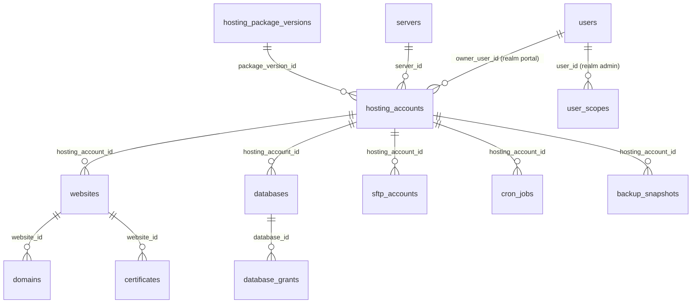

# Ownership và phạm vi truy cập dữ liệu

Tài liệu này mô tả **ai sở hữu bản ghi nào** và cách API giới hạn dữ liệu theo người gọi. Nguồn schema: [itso.dbml](../schema/itso.dbml). ERD nhóm Hosting: [erd-hosting.svg](erd/erd-hosting.svg).

## 1. Chuỗi sở hữu

- Gốc sở hữu là `hosting_accounts`. Chủ của account là `owner_user_id`, bắt buộc là user realm `portal` (trigger `hosting_owner_portal`).
- Mọi tài nguyên của account mang `hosting_account_id NOT NULL`: `websites`, `databases`, `database_users`, `sftp_accounts`, `ssh_keys`, `cron_jobs`, `upload_sessions`, `account_lifecycle_events`, `account_usage_snapshots`, `account_migrations`, `purge_records`.
- Tài nguyên cấp 2 sở hữu qua cha: `domains`, `website_settings`, `certificates`, `wordpress_sites`, `git_repositories` → `website_id`; `git_deployments` → `git_repository_id`; `database_grants` → `database_id`; `cron_runs` → `cron_job_id`; `dns_records` → `zone_id`.
- Có `hosting_account_id` **nullable** (bản ghi có thể thuộc server hoặc toàn hệ thống): `uid_allocations` (đã release), `dns_zones`, `terminal_sessions` (terminal root của admin), `backup_destinations`, `backup_snapshots` (backup cấp server), `malware_scans`, `quarantine_items`, `metric_samples`, `metric_rollups`.
- Chỉ admin: nhóm `docker`, `firewall_rules`, `fim_baselines`, `software_catalog`, `server_*`, `agents`, `settings`, `audit_logs`.

## 2. Phạm vi theo vai trò

| Vai trò (realm) | Thấy gì | Cơ chế |
|---|---|---|
| SUPER_ADMIN (admin) | Toàn bộ | Không giới hạn; mọi thao tác ghi audit |
| ADMIN (admin) | Server và account được giao | `user_scopes (scope_type = server \| hosting_account)`; account thuộc server được giao cũng được thấy |
| USER (portal) | Chỉ account của chính mình và tài nguyên con | Global scope `owner_user_id = auth()->id()` trên `HostingAccount`, tài nguyên con lọc qua `whereHas('hostingAccount')` |

Quy tắc bắt buộc khi hiện thực ở Phase 3:

1. Mọi model có `hosting_account_id` dùng trait `BelongsToHostingAccount` áp global scope theo realm của người gọi. Không có query portal nào bỏ qua scope (`withoutGlobalScopes` bị cấm trong `app/Http/Controllers/Portal`, kiểm bằng PHPStan rule).
2. Route model binding ở portal trả **404** (không phải 403) khi tài nguyên không thuộc user, để không lộ sự tồn tại.
3. Test ma trận quyền: với mỗi endpoint portal, USER A không đọc/sửa được tài nguyên của USER B; ADMIN ngoài scope nhận 404.
4. Impersonation: admin xem portal dưới danh nghĩa USER chỉ qua `impersonation_sessions` (lý do bắt buộc, có hạn); audit ghi cả `actor_user_id` và `impersonator_user_id`.
5. RLS PostgreSQL là lớp bảo vệ thứ hai, đánh giá ở Phase 12.

## 3. Ràng buộc ở tầng database

| Ràng buộc | Cơ chế | Test |
|---|---|---|
| Realm bất biến | Trigger `users_realm_immutable` | `10_identity_realm.sql` |
| Vai trò khớp realm | CHECK `roles_key_realm_chk` + trigger `user_roles_realm_match` | `10_identity_realm.sql` |
| Chủ account là realm portal | Trigger `hosting_owner_portal` | `10_identity_realm.sql` |
| Không xóa cứng cha khi còn con | FK mặc định (NO ACTION ≈ RESTRICT); xóa là soft-delete hoặc purge có kiểm soát | `20_hosting.sql` |
| UID duy nhất mỗi server, dải 20000–59999 | Unique `(server_id, uid)` + CHECK | `20_hosting.sql` |
| Domain duy nhất trong bản ghi chưa xóa | Partial unique `domains_name_active_uq` | `30_domains.sql` |
